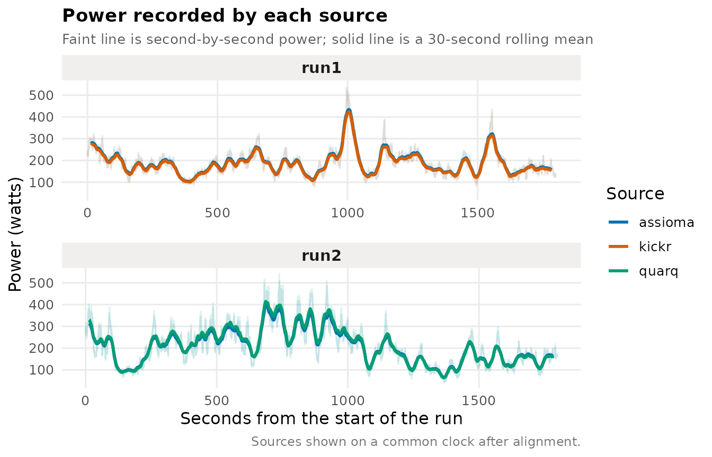
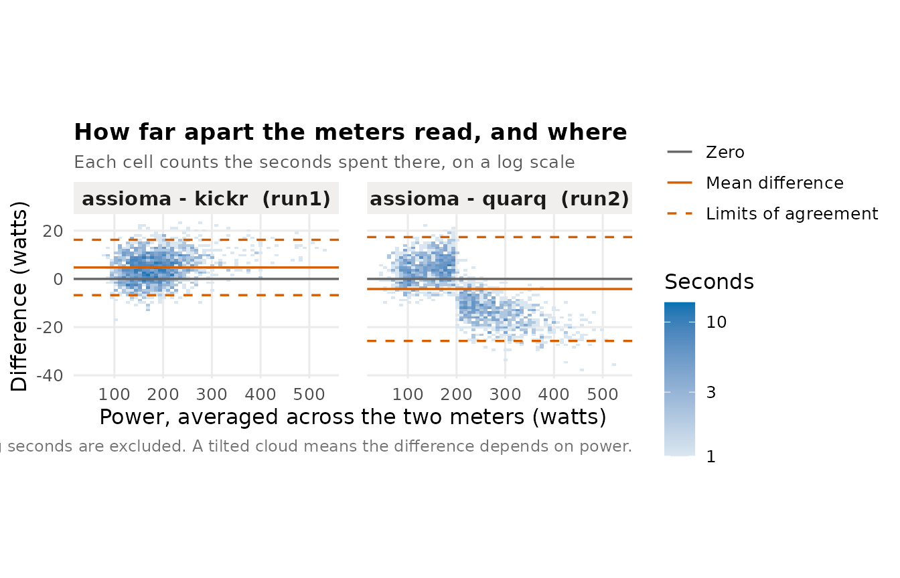
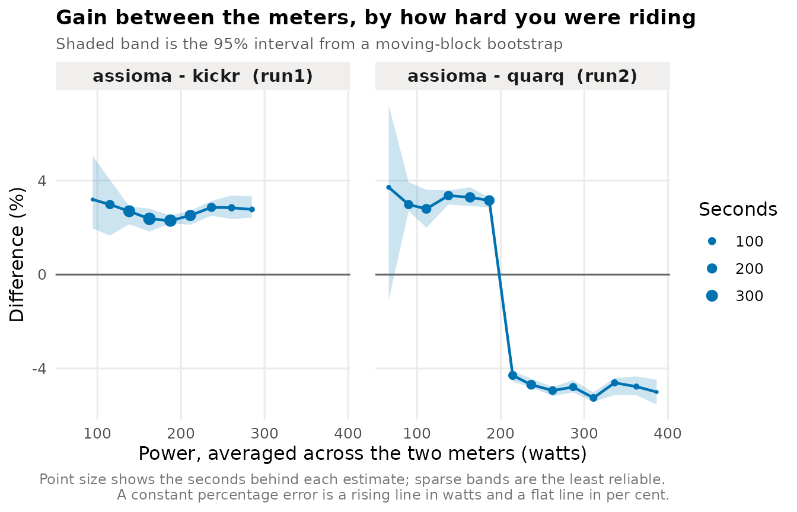
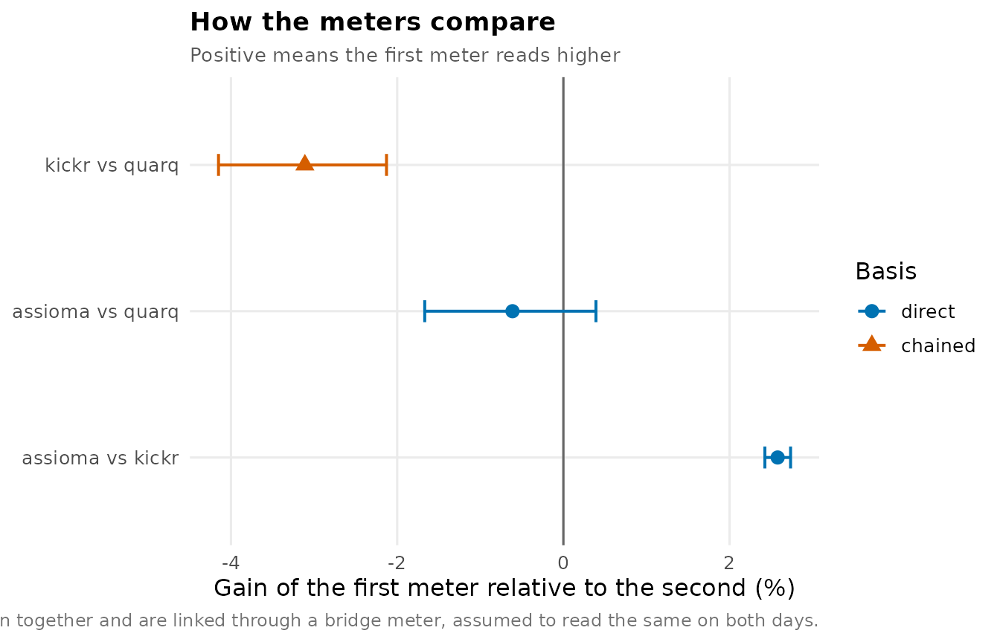

# Comparing power meters

Two power meters on the same bike rarely agree exactly, and the
interesting question is not whether they differ but by how much, and
whether the gap is steady or opens up as you push harder. This vignette
walks through that comparison, then through the harder case where a
third meter has to be brought onto the same scale without ever having
been ridden alongside the first.

``` r

library(cyclingpower)
```

Everything below runs on
[`demo_rides()`](https://jzuccollo.github.io/cyclingpower/reference/demo_rides.md),
which writes a small set of ride files with distortions chosen in
advance, so every number has a known answer to check against. Two
sessions:

| Run  | Meters         | What was planted                                    |
|------|----------------|-----------------------------------------------------|
| run1 | assioma, kickr | kickr reads 2.5% low, and its clock runs 7 s fast   |
| run2 | assioma, quarq | quarq reads 3% low below 200 W and 5% high above it |

assioma is in both, which is what makes the third meter reachable at the
end.

``` r

dir <- demo_rides()
list.files(dir)
#> [1] "run1_assioma.csv" "run1_kickr.csv"   "run2_assioma.csv" "run2_quarq.csv"
```

Real files replace these unchanged.
[`vignette("recording_rides")`](https://jzuccollo.github.io/cyclingpower/articles/recording_rides.md)
covers how to record them, and several of the decisions there —
recording rate, auto-pause, and what to ride — determine whether the
steps below can work at all.

## Getting files into the comparison

The unit of analysis is a run, meaning one session ridden once, recorded
by two or more sources. Hand
[`read_rides()`](https://jzuccollo.github.io/cyclingpower/reference/read_rides.md)
a directory and it reads the `run` and `source` labels off filenames
shaped `run1_kickr.csv`:

``` r

rides <- read_rides(dir)
rides
#> # A tibble: 7,200 × 4
#>    run   source  time                power
#>    <chr> <chr>   <dttm>              <dbl>
#>  1 run1  assioma 2026-03-14 09:00:00  234.
#>  2 run1  assioma 2026-03-14 09:00:01  227.
#>  3 run1  assioma 2026-03-14 09:00:02  243.
#>  4 run1  assioma 2026-03-14 09:00:03  220.
#>  5 run1  assioma 2026-03-14 09:00:04  248.
#>  6 run1  assioma 2026-03-14 09:00:05  251.
#>  7 run1  assioma 2026-03-14 09:00:06  264.
#>  8 run1  assioma 2026-03-14 09:00:07  291.
#>  9 run1  assioma 2026-03-14 09:00:08  298.
#> 10 run1  assioma 2026-03-14 09:00:09  305 
#> # ℹ 7,190 more rows
```

Every reader returns this same shape whatever the file format, so a GPX
exported from Strava and a FIT pulled off a head unit arrive with the
same column names and types. `time` and `power` are always present; the
other channels appear when the file carries them.

Where the filenames do not carry the labels, build the table yourself
and pass that instead —
[`read_rides()`](https://jzuccollo.github.io/cyclingpower/reference/read_rides.md)
takes a data frame of `path`, `run` and `source` just as happily as a
directory. A filename that does not split cleanly is an error rather
than a silently missing label.

``` r

one <- read_file(file.path(dir, "run1_kickr.csv"))
head(one, 3)
#> # A tibble: 3 × 2
#>   time                power
#>   <dttm>              <dbl>
#> 1 2026-03-14 09:00:07  227.
#> 2 2026-03-14 09:00:08  225.
#> 3 2026-03-14 09:00:09  235.
```

## Putting the sources on one clock

That seven-second offset matters. Differencing the two series on their
nominal timestamps compares power from one moment against power from
another, which inflates the spread and shifts the average difference,
and nothing about the result announces that it has happened.
[`align_rides()`](https://jzuccollo.github.io/cyclingpower/reference/align_rides.md)
resamples each source onto a one-second grid and recovers the offset by
cross-correlating the power traces.

``` r

aligned <- align_rides(rides)
alignment_report(aligned)
#> # A tibble: 4 × 7
#>   run   source  reference offset correlation sharpness status 
#>   <chr> <chr>   <chr>      <dbl>       <dbl>     <dbl> <chr>  
#> 1 run1  assioma assioma        0      NA        NA     assumed
#> 2 run1  kickr   assioma        7       0.996     0.113 aligned
#> 3 run2  assioma assioma        0      NA        NA     assumed
#> 4 run2  quarq   assioma        0       0.997     0.135 aligned
```

The seven seconds planted in kickr’s clock come back as seven. `offset`
is the correction applied, `correlation` how well the traces matched at
that offset, and `status` whether the offset was established at all.
Where both channels came off a single head unit the offset is zero and
the same code path serves. Where a ride was too steady to lock onto — a
long block at constant power has no features to align against — the
status comes back `unresolved`, the recorded timestamps stand, and a
warning says so.

``` r

plot_timeseries(aligned)
```



## How far apart do they read?

``` r

power_agreement(aligned)
#> run1: assioma reads 2.6% higher than kickr (95% CI 2.4 to 2.7, from 1,800 seconds)
#> run2: assioma reads 0.6% lower than quarq (95% CI -0.4 to 1.7, from 1,800 seconds)
#> 
#> # A tibble: 2 × 13
#>   run   source_a source_b seconds bias_w bias_lo bias_hi sd_difference loa_lo
#>   <chr> <chr>    <chr>      <int>  <dbl>   <dbl>   <dbl>         <dbl>  <dbl>
#> 1 run1  assioma  kickr       1800   4.74    4.20    5.23          5.86  -6.74
#> 2 run2  assioma  quarq       1800  -4.19   -6.82   -1.74         11.0  -25.7 
#> # ℹ 4 more variables: loa_hi <dbl>, gain_pc <dbl>, gain_lo <dbl>, gain_hi <dbl>
```

The sentence above the table is the answer; the columns are there to
check it. `bias_w` is the average difference in watts and `gain_pc` the
same thing multiplicatively, which is usually the more natural way to
think about a power meter, since meters tend to be a few per cent out
rather than a fixed number of watts out. kickr was built to read 2.5 per
cent low, and assioma against it comes back at about 2.6 per cent, which
is `1 / 0.975 - 1`. `loa_lo` and `loa_hi` bound the range within which
most individual seconds fall — a much wider range than the interval on
the average, and a different question.

Look at run2, though. Its interval straddles zero, which reads as *these
two meters agree*. Hold that thought.

The intervals come from a moving-block bootstrap rather than from
treating each second as an independent observation. Per-second power is
heavily autocorrelated — what you are riding now is nearly what you were
riding a second ago — so an hour’s recording carries far less
independent information than its 3,600 rows suggest, and an interval
built on the independence assumption would be roughly an order of
magnitude too narrow.

``` r

plot_agreement(aligned)
```



## Does the gap change with effort?

A single average difference hides the pattern that usually matters,
which is a meter agreeing at endurance pace and drifting at threshold.
[`agreement_by_level()`](https://jzuccollo.github.io/cyclingpower/reference/agreement_by_level.md)
bins the seconds by the mean of the two readings and reports the
difference within each band.

``` r

by_level <- agreement_by_level(aligned, width = 25)
plot_by_level(by_level, scale = "percent")
```



There is run2. The overall figure said the two meters agreed to within
half a per cent; the bands show quarq reading about three per cent low
up to 200 W and about five per cent high above it. The average was not
wrong — the errors really do cancel over this ride — but it describes no
part of the range, and on a ride weighted differently it would have come
out somewhere else entirely.

Seconds are binned on the mean of the two meters, never on one nominated
meter. If you bin by assioma and then plot assioma minus quarq against
those bins, assioma’s own measurement noise pushes the points into a
slope, and the trend you see is an artefact of the plotting.

[`level_dependence()`](https://jzuccollo.github.io/cyclingpower/reference/level_dependence.md)
states it rather than leaving it to the eye:

``` r

level_dependence(by_level)
#> # A tibble: 2 × 8
#>   run   source_a source_b low_band  low_gain high_band high_gain separated
#>   <chr> <chr>    <chr>    <chr>        <dbl> <chr>         <dbl> <lgl>    
#> 1 run1  assioma  kickr    175–200 W     2.30 75–100 W       3.20 FALSE    
#> 2 run2  assioma  quarq    300–325 W    -5.25 50–75 W        3.71 TRUE
```

`separated` is whether the extreme bands’ 95% intervals overlap, so a
pair with too few seconds to resolve anything does not fire. run1’s
clean 2.5 per cent gain is flat across the range and does not separate;
run2 does.

`seconds` travels with every row because time is not spread evenly
across the power range. The ends are usually thin, and an estimate
resting on twenty seconds deserves less weight than one resting on six
hundred.

## Bringing in a third meter

Now the awkward case. run1 carried assioma and kickr, run2 carried
assioma and quarq. kickr and quarq have never been on the bike together,
so there is no second at which both were measuring. assioma is the
bridge: each run gives a gain relative to it, and the difference between
those two gains is kickr against quarq.

``` r

chained <- chain_sources(aligned)
chained
#> assioma reads 2.6% higher than kickr (95% CI 2.4 to 2.7)
#> assioma reads 0.6% lower than quarq (95% CI -0.4 to 1.7)
#> kickr reads 3.1% lower than quarq (95% CI 2.1 to 4.2), chained via assioma
#> 
#> A chained pair assumes the bridge read identically on both days. 
#> The rides cannot test that. See chain_report().
#> 
#> # A tibble: 3 × 7
#>   source_a source_b basis   gain_pc gain_lo gain_hi via    
#>   <chr>    <chr>    <chr>     <dbl>   <dbl>   <dbl> <chr>  
#> 1 assioma  kickr    direct    2.58     2.42   2.73  NA     
#> 2 assioma  quarq    direct   -0.613   -1.67   0.392 NA     
#> 3 kickr    quarq    chained  -3.11    -4.15  -2.13  assioma
```

The `basis` column marks the last row as chained rather than directly
observed. The two direct comparisons rest on seconds where both meters
measured the same effort; the chained one rests on an assumption as
well.

``` r

plot_chain(chained)
```



The assumption is that assioma read the same on both days, and nothing
in the ride files can test it. A meter that drifted between the two
sessions moves the kickr-to-quarq figure by exactly the amount it
drifted, and nothing in the data separates that from a difference
between the meters. That is why the print method says so without being
asked.
[`chain_report()`](https://jzuccollo.github.io/cyclingpower/reference/chain_sources.md)
states it again and reports what *can* be checked, which is whether the
two runs covered comparable power — gains estimated over different parts
of the range are not really comparable at all.

``` r

report <- chain_report(chained)
report$assumption
#> [1] "Chained comparisons assume assioma read the same in every run. Nothing in the ride files can test that; any drift in assioma between runs is indistinguishable from a real difference between the meters being compared."
report$overlap
#> [1] 0.5596874
report$coverage
#> # A tibble: 2 × 5
#>   run   seconds median_power   p10   p90
#>   <chr>   <int>        <dbl> <dbl> <dbl>
#> 1 run1     1800         179. 125.   255.
#> 2 run2     1800         191.  99.0  331.
```

The chained interval is wider than either direct one it is built from.
It has to be: two independently bootstrapped runs are being subtracted.

## Doing all of it at once

[`compare_report()`](https://jzuccollo.github.io/cyclingpower/reference/compare_report.md)
runs this whole sequence and writes it out as a single HTML document,
which is usually what you want once the exploration is done. It takes
the same directory:

``` r

compare_report(dir, "power-comparison.html")
```

[`launch_app()`](https://jzuccollo.github.io/cyclingpower/reference/launch_app.md)
opens the same pipeline as a local web interface, with the settings live
and a download button that renders the report from the results already
on screen.

## Reading FIT files

FIT needs [FITfileR](https://github.com/grimbough/FITfileR), which is
not on CRAN. Everything above works without it; only `.fit` input needs
it.

``` r

read_file(system.file("extdata", "power1.fit", package = "cyclingpower")) |>
  head(3)
#> # A tibble: 3 × 6
#>   time                power cadence heart_rate speed distance
#>   <dttm>              <dbl>   <dbl>      <dbl> <dbl>    <dbl>
#> 1 2020-11-15 19:03:24   193      87         76  3.69     3.69
#> 2 2020-11-15 19:03:25   207      86         76  4.28     7.97
#> 3 2020-11-15 19:03:26   218      88         74  4.86    12.8
```
