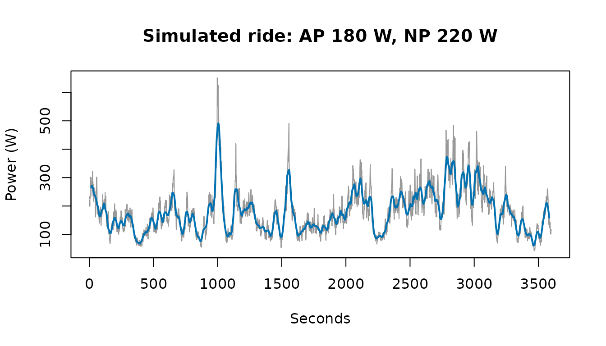
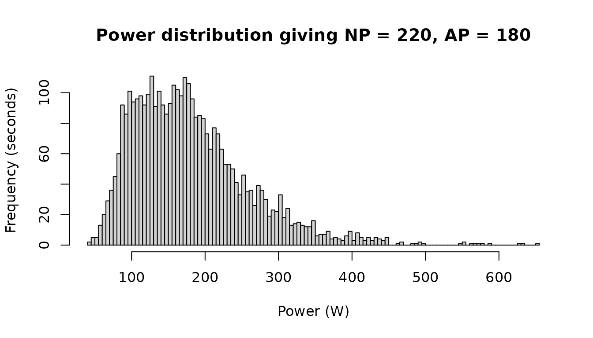
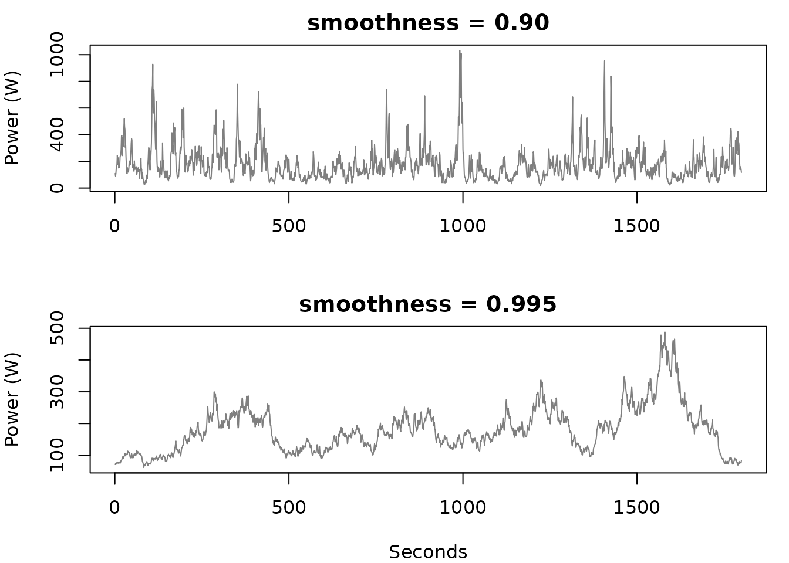

# What does it take to achieve a specific NP and AP?

``` r

library(cyclingpower)
```

Normalised power weights hard efforts more heavily than a plain average
does, so a given pair of average and normalised power implies something
about how ragged the ride was.
[`simulate_power()`](https://jzuccollo.github.io/cyclingpower/reference/simulate_power.md)
inverts the usual calculation: instead of summarising a ride you already
rode, it builds a second-by-second series that would produce the numbers
you name.

``` r

ride <- withr::with_seed(1, simulate_power(3600, target_ap = 180, target_np = 220))

c(average_power = average_power(ride), normalised_power = normalised_power(ride))
#>    average_power normalised_power 
#>              180              220
```

Both targets are hit exactly rather than approximately. The obvious way
to do this does not work well.

## Why not just optimise for it?

Asking an optimiser to choose all 3,600 values so that two summary
statistics come out right is a badly posed problem: 3,600 unknowns, two
constraints, and so infinitely many answers. It is also slow, and it
lands on whichever solution happens to sit nearest wherever the search
began.

A search starting from independent random values also has almost nothing
to work with. Normalised power is defined on a thirty-second rolling
mean, and independent noise averages away inside that window, so a
series of random draws has a variability index of 1 however wide its
spread.

``` r

noise <- withr::with_seed(1, stats::rpois(3600, 200))
variability_index(noise)
#> [1] 1.00022
```

Scatter alone cannot lift normalised power above the average. What lifts
it is sustained effort — holding 300 watts for two minutes, not
flickering between 50 and 550 from one second to the next.

## Shape first, then scale

So the shape comes from an autocorrelated process, which is what riding
looks like, and the two targets are then met without any search over the
ride.

Both metrics scale linearly with power, so their ratio is unaffected by
the overall level. That splits the problem cleanly in two. Raising the
series to a power stretches its peaks relative to its troughs and so
sets the variability index, `target_np / target_ap`; multiplying through
afterwards sets the average without disturbing the ratio. One monotone
equation in one unknown, solved to machine precision, rather than a
search over every second.

The result is a ride you could plausibly have done.

``` r

plot(
  ride,
  type = "l",
  col = "grey60",
  main = "Simulated ride: AP 180 W, NP 220 W",
  xlab = "Seconds",
  ylab = "Power (W)"
)
lines(zoo::rollmean(ride, 30, fill = NA), col = "#0072B2", lwd = 2)
```



The distribution behind that trace is skewed: a long stretch of moderate
power with occasional hard efforts, which is what pulls normalised power
forty watts clear of the average.

``` r

hist(
  ride,
  breaks = 100,
  main = "Power distribution giving NP = 220, AP = 180",
  xlab = "Power (W)",
  ylab = "Frequency (seconds)"
)
```



## Controlling the character of the session

`smoothness` sets how long efforts are held. It does not change the
statistics — both rides below hit the same average and normalised power
— but it changes the session those statistics describe, from a punchy
ride with frequent surges to a few long sustained blocks.

``` r

punchy <- withr::with_seed(3, simulate_power(1800, 180, 220, smoothness = 0.90))
sustained <- withr::with_seed(3, simulate_power(1800, 180, 220, smoothness = 0.995))

par(mfrow = c(2, 1), mar = c(4, 4, 2, 1))
plot(punchy, type = "l", col = "grey50", main = "smoothness = 0.90",
     xlab = "", ylab = "Power (W)")
plot(sustained, type = "l", col = "grey50", main = "smoothness = 0.995",
     xlab = "Seconds", ylab = "Power (W)")
```



## What the targets do not pin down

Two numbers do not make a ride. Nothing here knows about critical power,
so a normalised power you could not hold for an hour comes back as a
series that would exhaust anyone — but that is the target being
impossible, not the simulation misbehaving. A steady hour at the same
normalised power would fail the same test.

Within a feasible intensity the shape is reasonable, but the tail
underneath is lognormal and widens as the variability index rises. The
sustained peaks grow with it, and they grow out of proportion to each
other:

``` r

peak_over <- function(ride, window) {
  max(zoo::rollmean(ride, window, align = "right"))
}

vapply(c(steady = 190, ragged = 250), function(np) {
  ride <- withr::with_seed(1, simulate_power(3600, 180, np))
  c(`best 30s` = peak_over(ride, 30), `best 5min` = peak_over(ride, 300))
}, numeric(2))
#>             steady   ragged
#> best 30s  305.0352 645.8675
#> best 5min 234.1595 333.8548
```

A ragged ride posts a thirty-second best far above anything its
five-minute best would imply — not a power–duration curve any rider has.
So read a high variability index as the point where the output is still
a series with the right two numbers but no longer a plausible session.

Asking for a normalised power below the average is refused, since no
series has a variability index under 1. Asking for a very high one
alongside a low smoothness can also fail, because short surges cannot
lift a thirty-second average far; the error says so and suggests raising
`smoothness`.
